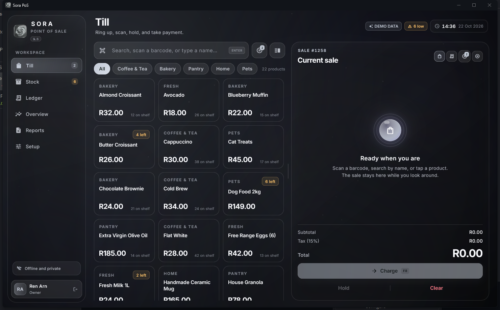
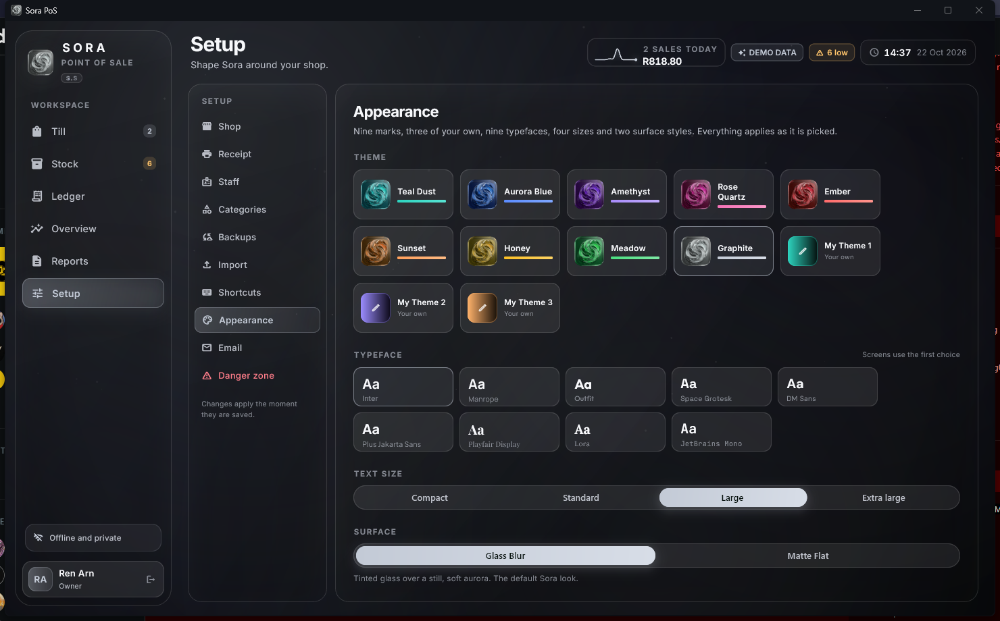
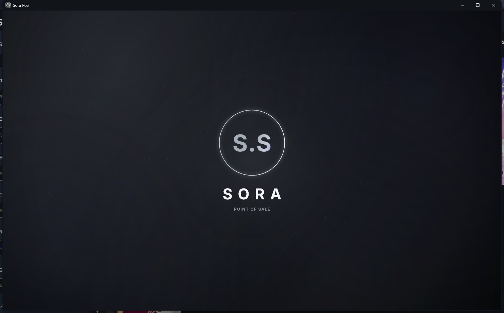
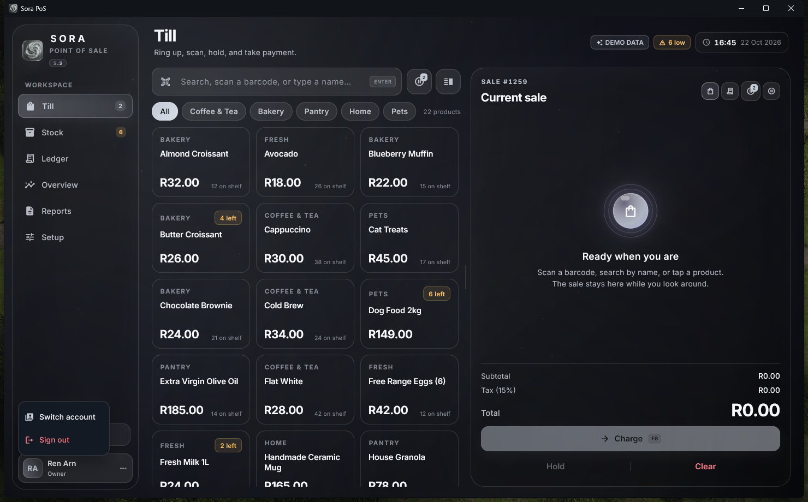
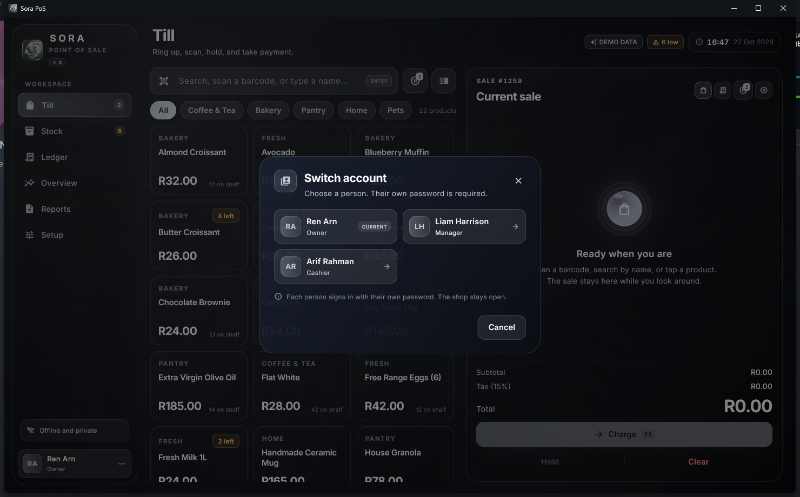

# Sora PoS

A calm, offline point of sale for small shops.

Sora PoS runs entirely on your Windows PC. It keeps the day-to-day till flow of
Lyra PoS, but rebuilds the interface, motion and drag handling from scratch. No
account, no cloud and no internet connection is required to sell.

[](#requirements)
[](https://github.com/shahittoshariear-spec/Sora-PoS/releases/tag/v0.3)
[](https://flutter.dev)
[](https://www.rust-lang.org)

| Till | Appearance | Sign-in |
| --- | --- | --- |
|  |  |  |

| Account menu | Switch account |
| --- | --- |
|  |  |

---

## Features

### Selling

- Search or scan anywhere on the Till
- Category filters and a compact product grid
- Quantity steppers, per-sale price override with approval, holds and resumes
- Cash, card or a split of both in one payment
- Quick cash totals, change calculation and a soft sale chime
- Resizable cart/receipt pane with snap points
- Live receipt preview, PDF saving and thermal receipt printing
- Refunds, partial refunds and voids behind a manager or owner password

### Stock

- Search-first stock table with add, edit, delete and bulk delete
- Scanner-first SKU field
- Low-stock warnings
- Stock and price changes are recorded in the audit trail
- Spreadsheet import for `.xlsx`, `.xls`, `.xlsb`, `.ods` and CSV

### Money and reporting

- Ledger with quick and custom date filters, search and reprint
- Overview by day, week, month or year
- Sales chart, payment ring, top sellers and low-stock cleanup
- Period history and itemised sale history
- Day reports with first/last sale, drawer expectation and payment split
- Hand-change and unaccounted-stock sections for the owner
- Save or print report PDFs, including a sales-history PDF
- Optional daily email report with a watch list of sensitive till events

### People and access

- Owner, manager and cashier roles
- Cashier: Till only
- Manager: Till, Stock and Ledger
- Owner: everything, including Overview, Reports and Setup
- Switch account from the bottom-left person menu without closing the shop;
  each person types their own password, and an open sale is held for the person
  leaving
- Salted SHA-256 passwords
- A private audit journal for removed till lines, cleared carts, discarded
  holds, stock edits, price changes, overrides, deleted products and voids

### Appearance

- Nine built-in themes and three custom theme slots
- Nine bundled typefaces and four text sizes
- Sidebar, top navigation or a floating command dock
- **Glass Blur** and **Matte Flat** surface styles
- Static aurora background with no continuous animation
- Reduced-motion support through the Windows setting
- Short post-sign-in brand sequence, skippable with any key

### Data

- Everything stays on this PC
- Single readable JSON data file
- Atomic saves, so an interrupted write does not leave a half-written shop
- Corrupt data is set aside instead of blocking startup
- Automatic daily, weekly and monthly backups (newest 12 kept)
- Export and import backups
- Mandatory safety backup before a reset
- First-run import from Lyra PoS, including products, categories, sales and staff

---

## Why Sora PoS

Sora PoS is the successor to Lyra PoS. It keeps the workflow a shop already
knows, but changes the parts that caused friction.

| Area | Sora PoS |
| --- | --- |
| Background | A fixed painted scene. It does not drift, breathe or follow the pointer, so it cannot flicker and costs nothing at rest. |
| Performance | No live backdrop blur. The till divider uses a painted guide and commits the layout once on release, avoiding the per-frame raster work that could make dragging fall behind the cursor. |
| Visuals | Glass Blur or Matte Flat, nine themes, three custom slots, nine typefaces, four text sizes and three navigation layouts. |
| Accounts | Owner, manager and cashier roles are enforced in navigation and on sensitive actions. |
| Oversight | A silent audit journal plus a red watch-list block in the daily email report. Staff never see a warning. |
| Deployment | A per-user installer that needs no administrator prompt, or a portable folder you can copy. |
| Layout | The live till pane can be resized and snaps to useful widths. The post-sale receipt stays fixed and readable. |
| Data | One local JSON file, atomic saves, automatic backups and export/import. No database server and no cloud account. |
| Hardware | Works with Windows printers, ESC/POS thermal printers and keyboard-wedge barcode scanners. Receipts can also be saved as PDF. |

---

## Requirements

### Minimum

| | |
| --- | --- |
| OS | Windows 10 or Windows 11, 64-bit |
| CPU | 64-bit dual-core processor, 2.0 GHz or faster |
| RAM | 4 GB |
| Storage type | Local HDD or SSD (NTFS) |
| Storage space | About 50 MB for the app; allow 250 MB free |
| Display | 1366 × 768 |
| Network | Not required to sell |
| Printer | Optional; on-screen and PDF receipts work without one |

### Recommended

| | |
| --- | --- |
| OS | Windows 11, 64-bit, current updates |
| CPU | Intel Core i5 / AMD Ryzen 5 or better, 4 cores or more |
| RAM | 8 GB or more |
| Storage type | SSD |
| Storage space | 1 GB free for sales history, backups and PDFs |
| Display | 1920 × 1080 or larger |
| Network | Internet only for optional email reports |
| Printer | Windows-compatible ESC/POS thermal receipt printer |
| Scanner | Keyboard-wedge barcode scanner (optional) |

A solid-state drive is strongly recommended. The app starts faster and the
data file and backups write more predictably. A local drive is preferred over a
network share.

---

## Download and install

The current release is **v0.3.0**:

<https://github.com/shahittoshariear-spec/Sora-PoS/releases/tag/v0.3>

### Installer

1. Download `SoraPos-setup-0.3.0.exe`.
2. Run it. The installer is per-user and does not need an administrator prompt.
3. Launch **Sora PoS** from the Start menu.

The installer is unsigned, so Windows SmartScreen may show a warning. Choose
**More info → Run anyway** if you trust the download.

### Portable

1. Download `SoraPos-release-win64.zip`.
2. Extract the whole folder somewhere local.
3. Run `sora_pos.exe` inside the folder.

Keep the folder together. `data`, `flutter_windows.dll` and the other files are
part of the app. The portable build does not install anything and does not
write to the registry.

### Demo

Download `SoraPos-demo-win64.zip` to try Sora PoS with sample products, staff and
sales. The demo build seeds a shop only when the data folder is empty.

| Person | Role | Password |
| --- | --- | --- |
| Ren Arn | Owner | `demo1234` |
| Liam Harrison | Manager | `manager1234` |
| Arif Rahman | Cashier | `cashier1234` |

---

## Migrating from Lyra PoS

On a fresh Sora install, the welcome screen looks for:

```
%APPDATA%\Lyra PoS\lyra-pos-data.json
```

If that file exists, it offers **Import this shop**. The import brings across:

- Products, SKUs, prices, costs and stock
- Categories
- Sales and refunds
- Held sales
- Shop details, printer, email and backup settings
- Theme, fonts, text size, navigation and keyboard shortcuts
- Staff names and roles

A few things work differently:

- **Passwords are not carried over.** Lyra stores unsalted hashes; Sora uses a
  salted hash. You choose a new owner password during the import, then set the
  other people's passwords in **Setup → Staff & access**.
- **Supplier names are not carried into Sora's product fields.**
- **The Lyra file is never modified.** Sora writes its own data file.

---

## Using Sora PoS

### First run

1. Open the app. If Sora finds a Lyra PoS shop, choose **Import this shop**.
   Otherwise, create a new shop with the form on the welcome screen.
2. Enter your name and a password. This first person becomes the owner.
3. Go to **Setup → Shop** to set the shop name, address, phone, currency, tax
   rate and low-stock level.
4. Go to **Setup → Receipt** to adjust the receipt footer and printer.
5. Go to **Setup → Staff** to add managers and cashiers.
6. Add categories in **Setup → Categories** and products in **Stock**.

### A normal sale

1. Sign in as a cashier, manager or owner.
2. Search or scan a product, or tap it in the Till grid.
3. Adjust quantities in the cart.
4. Press **F8** or choose **Charge**.
5. Enter a cash amount, a card amount, or split the two. The other field fills
   in automatically.
6. Take payment. Change is calculated, stock is updated and the receipt is
   ready to print or save.

Use **Hold** to park a sale and resume it later. Holds are listed on the Till.

### Refunds, voids and overrides

Refunds, voids and per-sale price overrides ask for a manager or owner
password. The signed-in cashier stays signed in.

### Reports and backups

- **Reports** shows the day's totals, payment split, top sellers, voids,
  hand-change audit and unaccounted stock.
- Use **Save PDF**, **Print** or **Email report** from Reports.
- **Setup → Backups** exports a backup and shows the automatic backups.
- **Setup → Appearance** changes themes, typefaces, text size, navigation and
  the surface style.
- **Setup → Email** configures optional Gmail SMTP reports. The app password is
  stored in Windows Credential Manager, not in the shop data file.
- **Setup → Danger zone → Reset all data** starts fresh. A safety backup is
  made first.

### Data location

Shop data lives at:

```
%APPDATA%\Sora PoS\sora-pos-data.json
```

Backups live in `%APPDATA%\Sora PoS\backups`. To move to another PC, copy the
whole `%APPDATA%\Sora PoS` folder while the app is closed, or use the backup
export and import in Setup.

---

## Build from source

### Prerequisites

- Windows 10/11, 64-bit
- Flutter 3.47.7 stable or newer
- Rust stable toolchain
- Visual Studio 2022 Build Tools with the **Desktop development with C++**
  workload and the Windows 10/11 SDK
- Inno Setup 6 (only for building the installer)

### Clone and run

```bash
git clone https://github.com/shahittoshariear-spec/Sora-PoS.git
cd Sora-PoS
flutter pub get
```

Build the Rust helper and copy it into the app assets:

```bash
cd rust_core
cargo build --release
cd ..
cp rust_core/target/release/sora_core.exe assets/bin/sora_core.exe
```

On PowerShell, the copy step is:

```powershell
Copy-Item rust_core\target\release\sora_core.exe assets\bin\sora_core.exe -Force
```

Run the app:

```bash
flutter run -d windows
```

### Release build

```bash
flutter build windows --release
```

The runnable bundle is in `build/windows/x64/runner/Release`. Keep the whole
folder together.

Demo build:

```bash
flutter build windows --release --dart-define=SORA_DEMO=true
```

### Installer

With Inno Setup 6 installed:

```powershell
powershell -ExecutionPolicy Bypass -File tools/build-installer.ps1
```

The installer is written to `release/SoraPos-setup-0.3.0.exe`.

Sora PoS does not use Flutter plugins, so Windows Developer Mode is not
required. The Rust helper must be copied to `assets/bin/` before building the
Windows bundle.

---

## Printing and hardware

- Receipt printing uses raw ESC/POS through the Rust helper. Choose the printer
  in **Setup → Receipt**.
- With no printer selected, receipts can be saved as PDF or sent through the
  Windows print driver.
- Keyboard-wedge barcode scanners work in the Till search field.
- Receipt paper is monochrome-friendly.

---

## FAQ

**Does Sora PoS need the internet?**
No. Selling, stock, reports and backups are local. The internet is only used if
you turn on the optional email report.

**Does it work on Windows 10?**
Yes, 64-bit Windows 10 and Windows 11 are supported.

**Is there a Mac or Linux version?**
No. The app uses Windows printing, native dialogs and Windows Credential
Manager through a Rust helper.

**Can several people use it?**
Yes. Each person has their own password and role. The role decides which
sections they can open and which actions need approval.

**Can I use a touchscreen?**
A touchscreen works as a pointer, but Sora PoS is designed for a mouse and
keyboard first. There is no separate touch layout.

**Can I import my Lyra PoS shop?**
Yes. On a fresh Sora install, if `%APPDATA%\Lyra PoS\lyra-pos-data.json` exists,
the welcome screen offers to import it. Staff passwords must be reset because
the two apps hash passwords differently.

**Can I move my data to another PC?**
Yes. Close the app, copy `%APPDATA%\Sora PoS` to the same location on the new
PC, or use the backup export and import in Setup.

**How do I uninstall it?**
Use **Settings → Apps → Sora PoS → Uninstall**, or the uninstaller in the
install folder. Uninstalling the app does not delete your shop data. Delete
`%APPDATA%\Sora PoS` separately if you want to remove that too.

**Where do I report a bug?**
Open an issue on GitHub with your Windows version, app version, what you did
and what happened. Screenshots help.

---

## Contributing

Issues and pull requests are welcome. Please keep changes focused and describe
the Windows version and steps to reproduce a bug. If you change behaviour, add
or update the relevant test.

```bash
flutter analyze
flutter test
cargo test --manifest-path rust_core/Cargo.toml
```

---

## Built with

- [Flutter](https://flutter.dev) for the interface
- [Rust](https://www.rust-lang.org) for printing, native dialogs, spreadsheet
  reading and Windows Credential Manager
- Pure Dart dependencies; no Flutter plugins

---

## Version

**0.3.0** — Lyra PoS import and staff password reset flow.

## Changelog

### 0.3.0 — 24 Oct 2026

- First-run import from Lyra PoS.
- Products, categories, sales, refunds, holds, settings and staff are carried over.
- The owner sets a new password during import; other staff are reset in Setup.
- Lyra passwords are never reused, and the Lyra data file is left untouched.

### 0.2.0 — 22 Oct 2026

- Switch account from the bottom-left person menu, top-nav chip or command dock.
- The incoming person types their own password; an open sale is held for the
  person leaving.
- Role-restricted navigation updates immediately after a switch.
- The post-sign-in brand sequence runs for the new person.

### 0.1.0 — 22 Oct 2026

- First public release.
- Windows installer and portable builds.
- Static aurora background and a short post-sign-in brand sequence.
- Glass Blur and Matte Flat surface styles.
- Resizable till pane, split payments, holds, refunds and voids.
- Stock, ledger, overview and reporting.
- Role-based access and a private audit journal.

## License

No license has been published yet. Until a license is added, all rights are
reserved by the author.
